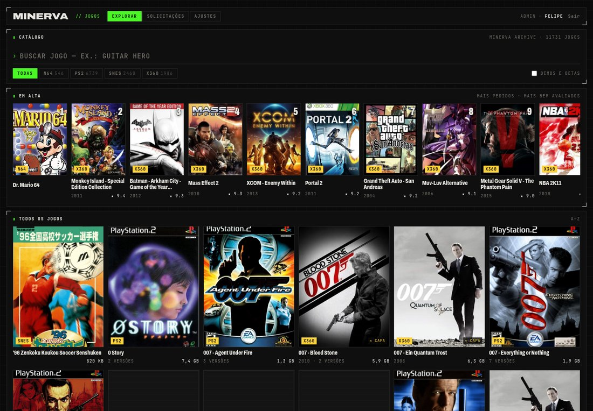
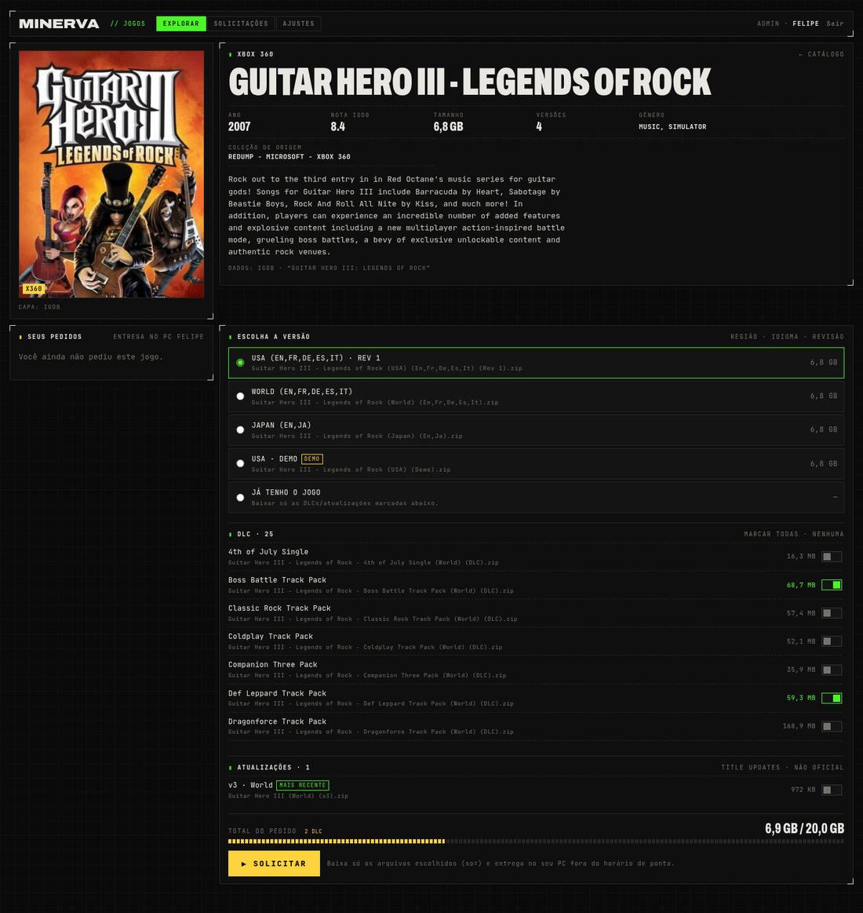

# minerva-seerr

Portal de pedidos de jogos para a casa, no estilo do Overseerr/Jellyseerr, em cima do catálogo público do
**Minerva Archive**.

A pessoa entra, procura o jogo, escolhe a versão (região, idioma, revisão) e, no Xbox 360, as DLCs e
atualizações que quer. O app manda o **qBittorrent** baixar **só esses arquivos** do torrent da coleção, sem
baixar a coleção inteira. Opcionalmente, um worker leva o resultado para o PC de quem pediu e apaga do servidor.

- **Hospedar o seu:** [docs/INSTALAR.md](docs/INSTALAR.md) (Docker Compose, ~15 min)
- **Operar no dia a dia:** [docs/OPERACAO.md](docs/OPERACAO.md)
- **Como funciona por dentro:** [docs/ARQUITETURA.md](docs/ARQUITETURA.md)

## O que tem

- **Explorar**: busca rápida (SQLite FTS5), filtro por console, faixa "Em alta" e rolagem infinita.
- **Página do jogo**: capa, sinopse, ano, nota e gênero (libretro-thumbnails + IGDB), versões agrupadas e, no
  Xbox 360, um interruptor por DLC e por title update. O total é conferido contra o limite enquanto você escolhe.
- **Solicitações**: progresso ao vivo, cancelar, aprovar (admin) e repetir.
- **Ajustes** (admin): limite de GB por pedido, pedidos por dia, espaço mínimo no qBit, aprovação, pasta no PC,
  teste do qBit, chaves do IGDB, atualização do índice, usuários e troca de senha.
- **Usuários** com papel (admin/usuário) e um PC de entrega por pessoa.
- **Link de configuração de uso único** para criar o primeiro admin e colar chaves sem terminal.
- Funciona no celular; visual "telemetria" (grafite, fonte mono, títulos condensados, acento amarelo).

| Explorar | Página do jogo com DLCs |
|---|---|
|  |  |

## Em uma linha cada

| Peça | Tecnologia |
|---|---|
| Backend | Python 3.13, FastAPI, SQLite (WAL, FTS5 trigram) |
| Frontend | Jinja + HTMX + Alpine.js, servidos pelo próprio app (sem build, sem CDN de JS) |
| Downloads | qBittorrent Web API v2 (torrent da coleção parado → prioridade 0 em tudo → liga só o pedido) |
| Metadados | libretro-thumbnails (GitHub), IGDB (Twitch, opcional) |
| Entrega | worker em Python no host: Wake-on-LAN, SSH + `tar`, aviso no Discord (opcional) |
| Testes | 70 testes `unittest`, incluindo bencode/infohash com padding e o `so=` de um torrent real |

## Coleções

Padrão: Redump Xbox 360 e PS2, No-Intro SNES e N64 (BigEndian), mais as DLCs e os title updates do Xbox 360.
`MINERVA_COLECOES` no `.env` troca a lista (separada por `;`; `*` = as ~1.050 coleções do índice).

## Rodando rápido

```bash
cp .env.example .env && chmod 600 .env      # ajuste MINERVA_URL e QBIT_URL
docker compose up -d --build
docker compose exec app python -m app.indexer atualizar
docker compose exec app python -m app.configurar   # abra o link e crie o admin
```

Detalhes, qBittorrent, HTTPS, IGDB e entrega no PC: [docs/INSTALAR.md](docs/INSTALAR.md).

## Segurança

- Feito para a **rede de casa**. Não exponha na internet; para acesso de fora, use VPN (Tailscale/WireGuard).
- Senhas com PBKDF2-SHA256 (240 mil iterações), sessão em cookie `HttpOnly` + `SameSite=Lax` (+ `Secure` por HTTPS).
- Ações de admin (ajustes, indexador, capas, aprovação) exigem sessão de admin; o worker usa um token próprio.
- Segredos só no `.env` (600) e no banco do app; nada disso vai para o git.

## Aviso

O app só organiza um índice público e pede ao seu qBittorrent os arquivos escolhidos. Você é responsável pelo que
baixa; respeite as leis do seu país.

## Neste homelab

- Roda no **CT210** `minerva` (10.0.77.41, Debian 13, Docker) em `/opt/minerva-seerr`; nome
  **https://minerva.home** pelo Caddy do CT204; DNS pelo curinga `*.home` do Pi-hole (CT203).
- qBittorrent do **CT206** (categoria `minerva`); entrega pelo worker `/usr/local/bin/homelab-minerva-entrega.py`
  (cron `/etc/cron.d/homelab-minerva-entrega`, mesmo lock do torrentbot `/run/homelab-torrent-destino.lock`).
- Avisos no #pedidos-torrent pelo bot do torrentbot (CT201). Monitor no Uptime Kuma `CT210 - Minerva Web` e item
  "Minerva" no painel `homepage.home`.
- Documentação do homelab: `/opt/homelab-memory/services/ct210-minerva-seerr.md` e `/root/mudancas-homelab.md`.

---
Projetado e operado por feartsOFC. O Claude Code ajudou na investigação e na manutenção.
